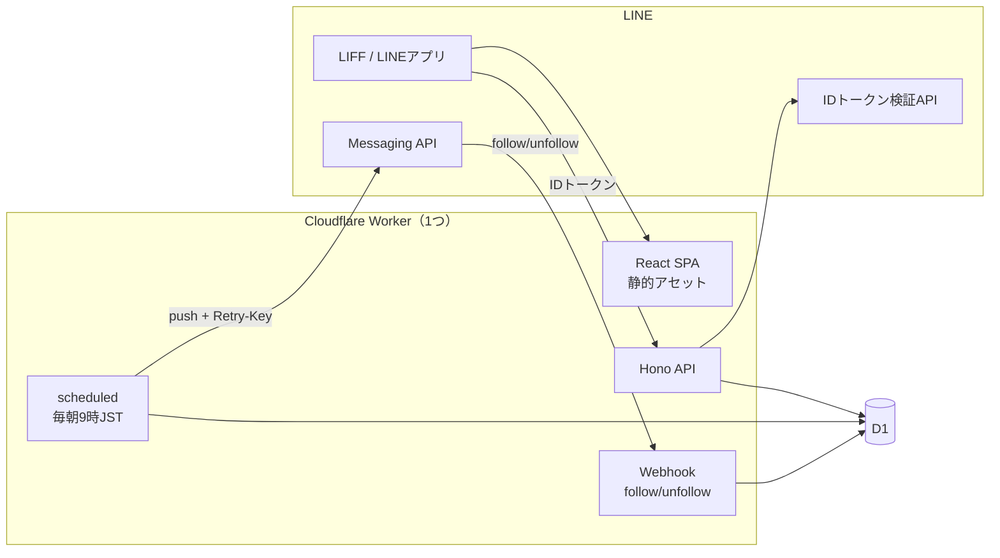
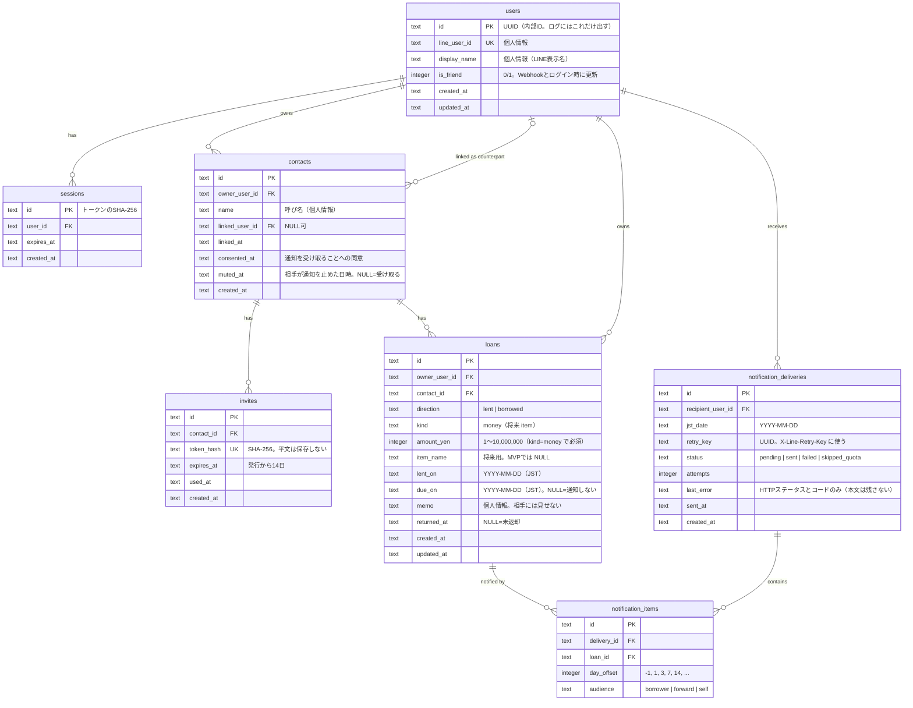

# 設計書（lend-tracker）

> 状態：フェーズ2で承認済み（2026-11-09）。

## 1. 無料枠・制約の確認結果（2026-11-09 時点）

| 項目 | 値 | 出典 |
|---|---|---|
| Workers Free：リクエスト | 100,000 / 日（UTC 0時リセット） | https://developers.cloudflare.com/workers/platform/limits/ |
| Workers Free：CPU時間 | 10 ms / HTTPリクエスト、10 ms / Cron 1回 | 同上 |
| Workers Free：Cron Triggers | 5 / アカウント | 同上 |
| Workers Free：サブリクエスト | 50 / 1回の実行 | 同上 |
| Workers 静的アセット | 静的アセットへのリクエストは無料・無制限 | https://developers.cloudflare.com/workers/static-assets/billing-and-limitations/ |
| Cron の時刻 | UTCで実行。厳密な実行時刻の保証は記載なし。設定変更の反映に最大15分 | https://developers.cloudflare.com/workers/configuration/cron-triggers/ |
| D1 Free | 読み取り 500万行/日、書き込み 10万行/日、合計 5 GB、1DB 500 MB、10 DB/アカウント、Time Travel 7日 | https://developers.cloudflare.com/d1/platform/pricing/ ・ https://developers.cloudflare.com/d1/platform/limits/ |
| Pages Free | 500ビルド/月。Functions のリクエストは Workers の枠を使う | https://developers.cloudflare.com/pages/platform/limits/ |
| LINE公式アカウント（日本）コミュニケーションプラン | 無料メッセージ 200通/月、追加メッセージ不可 | https://www.lycbiz.com/jp/service/line-official-account/plan/ |
| LINE 通数の数え方 | push・multicast・broadcast・narrowcast が対象。reply は対象外。**受信者数で数える**（1リクエスト内のメッセージオブジェクト数は関係しない）。ブロック中のユーザーへの送信は数えない | https://developers.line.biz/en/docs/messaging-api/pricing/ ・ https://developers.line.biz/en/docs/messaging-api/sending-messages/ |
| LINE 再送キー | `X-Line-Retry-Key`（UUID）。push 等で使える。24時間有効。受理済みなら `409` | https://developers.line.biz/en/docs/messaging-api/retrying-api-request/ |
| LINE 送信数の確認 | `GET /v2/bot/message/quota`、`GET /v2/bot/message/quota/consumption` | https://github.com/line/line-openapi（messaging-api.yml） |
| LINE ユーザーID | プロバイダーごとに異なる。同じプロバイダー内なら LINEログインチャネルと Messaging API チャネルで同じ値 | https://developers.line.biz/en/docs/messaging-api/getting-user-ids/ |
| IDトークン検証 | `POST https://api.line.me/oauth2/v2.1/verify`（`id_token`, `client_id`）→ `sub`, `aud`, `exp` | https://developers.line.biz/en/docs/line-login/verify-id-token/ |
| 友だち状態 | `liff.getFriendship()`（`profile` スコープ、LIFFと同じログインチャネルに公式アカウントを連携） | https://developers.line.biz/en/reference/liff/ |
| 友だち追加の誘導 | ログインチャネルに公式アカウントを連携し `bot_prompt=normal/aggressive` | https://developers.line.biz/en/docs/line-login/link-a-bot/ |
| Vercel Hobby Cron | 1日1回まで。実行時刻は ±59分（1:00指定→1:00〜1:59） | https://vercel.com/docs/cron-jobs/usage-and-pricing |
| Supabase Free | DB 500 MB、アクティブ2プロジェクト、**1週間操作がないと一時停止** | https://supabase.com/pricing |

**未確認の項目**
- 無料プランで月200通を超えたときに、push API が何を返すか（HTTPステータス）。実装時にテスト用チャネルで確かめるか、送信数の確認APIで事前に止める
- D1 への問い合わせが「サブリクエスト 50回」に数えられるか
- Supabase の「操作がない」が何を指すか（Cronからの問い合わせで停止を防げるか）
- LIFFアプリの「友だち追加オプション」の現在の設定画面（手順書を作ったあと、実際の画面で確認する）

## 2. 構成案の比較

| 観点 | **案A：Cloudflare 一式（推奨）** | 案B：Vercel + Supabase |
|---|---|---|
| 構成 | Workers 1つで Hono API と React SPA（静的アセット）を配信。D1 と Cron Triggers を使う | Vercel Functions（Hono）と Vite SPA。Supabase Postgres と Vercel Cron を使う |
| 9時通知の精度 | Cron（UTC `0 0 * * *` = JST 9:00）。厳密な保証の記載はないが、Vercelのような±59分の明記もない | 9:00〜9:59 のどこかで実行される（公式に明記） |
| 休止のリスク | なし | 1週間操作がないと一時停止（2〜5人の利用では起こりうる） |
| DB | SQLite（D1）。Time Travel は7日 | Postgres。機能は豊富 |
| 制約 | CPU 10 ms/回。重い処理はできない（今回の処理は I/O が中心なので問題にならない見込み） | 関数の実行時間には余裕がある |
| 出どころの一体性 | APIと画面が同じドメインになり、CORSが要らない。デプロイも1回で済む | 2つのサービスにまたがる |
| ローカル開発・テスト | wrangler / `@cloudflare/vitest-pool-workers` で D1 をローカルで動かせる | Supabase CLI（Docker）が必要 |
| 費用 | 無料枠で足りる | 無料枠で足りる |

**推奨：案A。** 決め手は、通知時刻の精度、休止のリスクがないこと、1つのデプロイで済むこと、の3点です。Pages ではなく「Workers + 静的アセット」を使うのは、APIと画面を1つのWorkerにまとめ、Cron も同じWorkerに置けるからです。



## 3. ドメインモデル（相手を「連絡先」として持つ）

相手との連携は**貸し借り1件ごとではなく、相手（連絡先）単位**で行う。同じ相手と2回目以降に貸し借りしても、招待をやり直さなくてよいようにするため。

- 利用者（user）は連絡先（contact）を持つ。連絡先は、貸し借りの相手につけた呼び名（例：「ケンタ（バイト）」）
- 連絡先は、相手が招待を受けると、相手の user と結びつく（`linked_user_id`）
- 貸し借り（loan）は「自分（owner）× 連絡先 × 方向（lent / borrowed）」の組み合わせで記録する

**通知の送り先を決める規則**（「借りた人」に送る）

| loan.direction | 相手の状態 | 送り先 | 文面の種類 |
|---|---|---|---|
| `lent`（自分が貸した） | 連携済み、同意済み、友だち、通知を止めていない | 相手 | `borrower`：相手あての丁寧なお知らせ |
| `lent` | 上の条件を1つでも満たさない | 自分 | `forward`：転送用の催促文と、アプリへのリンク |
| `borrowed`（自分が借りた） | どの状態でも | 自分 | `self`：返却期限のリマインド |

## 4. ER図



**制約（主なもの）**
- `UNIQUE(notification_deliveries.recipient_user_id, jst_date)`：同じ人に1日2通送らない
- `UNIQUE(notification_items.loan_id, day_offset)`：同じ貸し借りの同じ段階を2回通知しない
- `UNIQUE(contacts.owner_user_id, linked_user_id)`：同じ相手を二重に連携しない
- `CHECK(amount_yen BETWEEN 1 AND 10000000)`、`CHECK(direction IN ('lent','borrowed'))`
- 外部キーは `ON DELETE CASCADE`。例外として `contacts.linked_user_id` は `ON DELETE SET NULL`

### 削除の方針：物理削除

- 貸し借り・連絡先・退会は**物理削除**にする。個人情報を必要以上に残さないため。取り消しができないので、UIで確認ダイアログを出す
- 「返却済み」は削除ではなく、`returned_at` に日時を入れて表す
- 通知履歴：貸し借りを削除すると、`notification_items` も一緒に消える（CASCADE）。`notification_deliveries` には個人情報を持たせない（内部IDと状態だけ）。ただし、受け取った人が退会したら一緒に削除する
- 退会：自分の users 行を削除すると、sessions・contacts・invites・loans・自分あての通知履歴が消える。自分が**相手として**連携されていた連絡先は `linked_user_id` が NULL になり、相手側（貸した人）の記録は残る。その記録は貸した人のデータだから
- 連絡先の削除：貸し借りが残っている場合は `409` を返し、先に貸し借りを消してもらう（一緒に消えて驚かせないため）

### 将来拡張がDB設計に与える影響（1行ずつ）

- 品物：`loans.kind` と `loans.item_name` を今のうちに用意する。`amount_yen` は「kind=money のとき必須」をアプリ側で検証する
- 一部返済：残高の列は作らない。将来 `repayments` テーブルを追加し、合計から残高を計算する
- 「返しました」報告と返済予定日の変更（Should）：`loan_events`（種類、誰が、いつ、値）テーブルを追加する。loans を直接書き換えず、貸した人が承認する形にできる
- 複数人での共有（割り勘）：loan と contact が1対1なので、将来は `loan_participants` へのマイグレーションが必要になる（今は複雑さを避けるため対応しない）
- 画像の添付：R2 と `attachments` テーブルを後から追加する。今は列を作らない
- 共有リンク：`invites` の仕組み（ハッシュ化したトークン、有効期限）をそのまま使い回す

## 5. 認証と認可

**ログイン**
1. LIFF で `liff.getIDToken()` を取得し、`POST /api/auth/login` に送る
2. サーバーは LINE の verify API で検証し、`aud` が自分のチャネルIDと一致するか確かめる。`sub` で users を upsert する
3. 32バイトのランダムなセッショントークンを発行する。DB にはその SHA-256 だけを保存し、`HttpOnly; Secure; SameSite=Lax` の Cookie で返す（有効期限30日）

**この方式を選んだ理由**：リクエストのたびに LINE へ検証しに行かずに済む。退会やログアウトのとき、DBの行を消せばセッションを確実に無効にできる。

**テスト用の認証**：環境変数 `AUTH_TEST_MODE=1` のときだけ `POST /api/test/login` を有効にする。本番の `wrangler.jsonc` の env にはこの変数を設定しない。さらに、本番の値が入っている状態で起動したらエラーで止める。

**認可の表**（どれにも当てはまらない場合は `404`。存在するかどうかを他人に知らせないため）

| 対象 | 持ち主（owner） | 連携済みの相手 | それ以外 |
|---|---|---|---|
| 貸し借りの一覧・詳細 | 読み書きできる | **見るだけ**（金額、日付、方向、返却状態、貸した人の表示名。memo と連絡先の呼び名は**見せない**） | 404 |
| 貸し借りの作成・編集・削除・返却済み | できる | 404 | 404 |
| 連絡先、招待の発行 | できる | 404 | 404 |
| 通知の停止・連携の解除 | — | できる（自分の連携だけ） | 404 |

すべてのクエリに `owner_user_id = :me`、または `linked_user_id = :me` の条件を付ける。これは、データ取得のための関数（リポジトリ層）で必ず受け取る引数にする。

## 6. API一覧

| メソッド | パス | 誰が | 内容 |
|---|---|---|---|
| POST | `/api/auth/login` | 誰でも | IDトークンを検証してセッションを作る |
| POST | `/api/auth/logout` | ログイン中 | セッションを削除する |
| GET | `/api/me` | ログイン中 | 表示名、友だち状態 |
| PATCH | `/api/me/friendship` | ログイン中 | `liff.getFriendship()` の結果を反映する |
| DELETE | `/api/me` | ログイン中 | 退会（全データを削除） |
| GET / POST | `/api/contacts` | 持ち主 | 連絡先の一覧・作成 |
| PATCH / DELETE | `/api/contacts/:id` | 持ち主 | 呼び名の変更・削除（貸し借りがあれば 409） |
| POST | `/api/contacts/:id/invites` | 持ち主 | 招待URLを発行する（それまでの未使用分は無効にする） |
| GET | `/api/loans?status=open\|returned&contactId=` | 持ち主 | 一覧（期限超過のフラグと最後に通知した日を含む） |
| POST | `/api/loans` | 持ち主 | 登録 |
| GET / PATCH / DELETE | `/api/loans/:id` | 持ち主 | 詳細・編集・削除 |
| POST / DELETE | `/api/loans/:id/return` | 持ち主 | 返却済みにする・取り消す |
| GET | `/api/invites/:token` | ログイン中 | 招待の内容（貸した人の表示名）。期限切れ・使用済みなら 410 |
| POST | `/api/invites/:token/accept` | ログイン中（本人以外） | 同意して連携する（`{ consent: true }` が必須） |
| GET | `/api/shared/loans` | 相手 | 自分あての貸し借り（見るだけ。項目を限定する） |
| PUT / DELETE | `/api/shared/links/:contactId/mute` | 相手 | 通知を止める・再開する |
| DELETE | `/api/shared/links/:contactId` | 相手 | 連携を解除する |
| POST | `/webhook/line` | LINE | `X-Line-Signature` を検証し、follow / unfollow で `is_friend` を更新する |
| POST | `/api/test/login` | テストのときだけ | E2E用 |
| — | `scheduled()` | Cron | 通知（7章） |

入力は Zod で検証する。エラーは `{ error: { code, message } }` の形で返し、`message` は日本語にする。内部の例外の内容は返さない。

## 7. 通知ロジック

**純粋関数**（`src/shared/notification/`。テストでは現在時刻を引数で固定する）

```ts
toJstDate(now: Date): string                  // UTC→JSTの日付 'YYYY-MM-DD'
dayOffset(dueOn: string, today: string): number // today - dueOn（日数）
isNotifyDay(d: number): boolean               // d === -1 || d === 1 || d === 3 || (d >= 7 && d % 7 === 0)
resolveAudience(loan, contact): 'borrower' | 'forward' | 'self'
planDeliveries(loans, contacts, today): Plan[] // 受け取る人ごとにまとめる
renderMessage(plan): LineTextMessage           // 文面のテンプレート
```

境界値のテスト例：UTC `2026-11-08T14:59:59Z`（JST 23:59:59）→ 11-08、`15:00:00Z` → 11-09。d = -2, -1, 0, 1, 2, 3, 4, 6, 7, 8, 13, 14, 21。月末・年末・うるう日（2028-02-29）をまたぐ場合。

**Cron の設定**（3本。上限は5本）
- `0 0 * * *`（JST 9:00）：計画を作って送る
- `30 0 * * *`、`30 1 * * *`：再送（未送信と失敗分。その日の計画づくりもやり直すので、9時の実行が丸ごと失敗しても拾える）

**1回の実行の流れ**
1. `today = toJstDate(now)`
2. 未返却で、`due_on` があり、`isNotifyDay` が真になる貸し借りを取り出す
3. `notification_deliveries` を `INSERT OR IGNORE`（受け取る人 × today）。`notification_items` も `INSERT OR IGNORE` する。UNIQUE制約があるので、何度実行しても結果は同じ（冪等）
4. 送信数の確認APIで今月の送信数を調べる。上限に近い場合（既定：残り5通以下）は `skipped_quota` にして送らない
5. `pending` / `failed`（attempts < 3）の delivery を送る。`X-Line-Retry-Key = delivery.retry_key` は固定値なので、LINE 側でも二重送信にならない。`409` は送信済みとして扱う
6. 成功 → `sent`。`4xx`（`409` と `429` を除く）→ `failed` にして再送しない。`429` / `5xx` / ネットワークのエラー → `failed` にして次の Cron で再送する
7. ログに出すのは、件数と delivery の ID とステータスコードだけ

**取りこぼし**：その日の Cron が3本とも失敗した場合、その日の通知は送らない（次に通知する日にまとめて届く）。過去の分をさかのぼって送らないのは、何日も前の通知が後から届くと混乱させるため。

**文面の例**

- `borrower`（相手あて）
  > 【貸し借りのお知らせ】
  > 〇〇さん（貸した人の表示名）との記録について、お知らせします。
  > ・3,000円（11月1日）：返却期限の11月10日から3日が過ぎています
  > ご都合のよいときに、〇〇さんへのご返却をお願いします。
  > 確認・通知の停止はこちら：https://liff.line.me/...
- `forward`（相手が未連携。貸した本人あて）
  > ケンタ（バイト）さんへの3,000円が、期限から3日過ぎています。
  > ▼ そのまま送れる文
  > 「先日の3,000円の件、お手すきのときに返してもらえると助かります🙏」
  > ケンタさんに招待を送ると、次からはアプリが直接お知らせします：https://liff.line.me/...
- `self`（自分が借りた）
  > 〇〇さんから借りた3,000円の返却期限は明日（11月10日）です。

1通の中では、上限（既定10件）を超えた分を「ほか◯件はアプリで確認してください」とまとめる。

**通知数の試算**（受け取る人 × 通知する日で数える）
- 返却されない貸し借りが最初の30日に受ける通知は、d = -1, 1, 3, 7, 14, 21, 28 の **7通**
- 普通の利用（5人 × 月4件 = 20件。多くは3日以内に返る。平均2.5通）：**約50通/月**
- 厳しい場合（20件すべて返されない）：**約140通/月**。同じ相手への複数の通知は1通にまとまるので、実際はこれより少なくなる
- 200通に収まる見込み。そのうえで、送る前に残りの通数を確認して止める。開発用には**別のプロバイダー・別の公式アカウント**を使い、本番の枠を使わない

## 8. 開発用と本番用の分け方

- LINE：開発用プロバイダー（ログインチャネル、LIFF、Messaging API チャネル）と、本番用プロバイダーを分ける。ユーザーIDはプロバイダーごとに違うので、データが混ざらない
- Cloudflare：`wrangler.jsonc` の `env.production` と、開発用の D1 を別々に用意する。ローカルではローカルの D1 を使う
- 秘密情報：`LINE_CHANNEL_SECRET`、`LINE_CHANNEL_ACCESS_TOKEN`、`LINE_LOGIN_CHANNEL_ID` は `wrangler secret`、ローカルでは `.dev.vars`（gitignore に入れる）で管理する

## 9. トレードオフ（主なもの）

- 相手単位の連携：便利だが、相手が「この人からの通知」をまとめて止めることになる。貸し借りごとに止めることはできない
- 物理削除：個人情報を最小限にできる。そのかわり、誤って削除すると元に戻せない（確認ダイアログで防ぐ）
- 過去の分をさかのぼって送らない：混乱を防げるが、Cronの障害が1日続くと、その日の通知は届かない
- D1（SQLite）：無料で手軽に使えるが、Postgres ほどの機能はない。今回の規模では問題にならない
